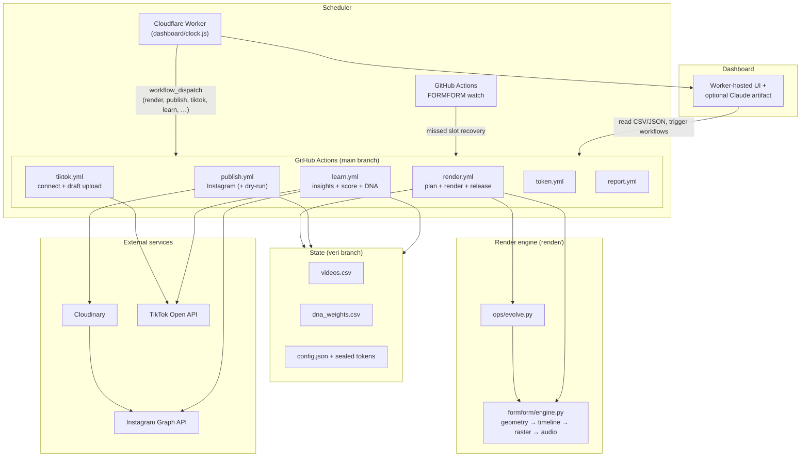

# FORM/FORM

[](https://github.com/tigerweirdo/formform)

> **Public mirror.** This repository is a **history-free snapshot** of the FORM/FORM codebase for portfolio and study. Live automation, performance data, and secrets live in a **private** production repository; this mirror is not wired to production accounts unless you configure your own.

**FORM/FORM** is a self-learning generative video system: it renders vertical seamless-loop abstract morph videos with procedurally generated ambient sound, publishes them to social platforms, measures 24h/72h performance, and feeds scores back into an evolving **DNA weighting** model that steers the next renders.

Live work: [Instagram @formformstudio](https://www.instagram.com/formformstudio)

## What it does

| Cadence | Behavior |
| --- | --- |
| **Twice daily** (06:30 & 18:30 Europe/Berlin) | Evolution engine plans a new spec → Python render engine produces **1080×1920** H.264 + AAC → GitHub Release stores `video.mp4` + JSON metadata |
| **After publish slots** (07:45 & 19:45) | Instagram Reels publish via Cloudinary URL; optional TikTok draft upload ~5 minutes later |
| **Every 3 hours** | Learning run: fetch Instagram (and synced TikTok) metrics, compute performance scores, update `dna_weights.csv` on the `veri` branch |
| **1st & 15th** | Instagram long-lived token refresh; sealed storage on `veri` |
| **Weekly** | Summary issue / notification |

Specs are **deterministic** from `video_id` (CRC32 seed). The evolution mix is **30%** random exploration, **70%** exploitation (**50%** elite crossover from top performers, **50%** DNA-weighted sampling). Learned dimensions include structure, palette, motion, lighting, format length, materials, transformations, caption hooks, sound style, and hashtags.

There is **no paid render API**: the motor runs entirely in GitHub Actions (ffmpeg + NumPy). Monthly spend target is **€0** on the free Actions minute budget, enforced by a **budget guard** that can drop to 720p **lite** renders (`seamless_8s`) when the month is tight; full budget allows `seamless_8s`, `seamless_15s`, and `seamless_30s` at 1080p.

## Architecture



**Why a Worker scheduler?** On private repos, GitHub’s `schedule` queue can lag by hours. A lightweight Cloudflare Worker wakes every five minutes, checks Berlin wall-clock slots, and dispatches workflows immediately (no runner minutes). If the Worker or dispatch token is missing, **watch** runs twice daily and replays missed slots.

## Notable engineering

- **Budget guard** (`ops/budget.py`): reads month-to-date Actions usage from the API, reserves non-render workflows, chooses full 1080p vs lite 720p/8s formats.
- **Quality gates** (`render/formform/engine.py`, `render/check.py`): reject empty, crushed, or silent outputs before release.
- **Self-healing**: per-video insight failures do not block the learn pipeline; TikTok upload uses bounded retries only on safe errors; publish uses atomic release claiming.
- **Watchdog** (`ops/watch.py` + `watch.yml`): detects never-started or failed clock slots and re-dispatches render → publish → tiktok chain.
- **Encrypted token storage** (`ops/seal.py`, `ops/tokens.py`): refreshed Instagram (and TikTok) tokens sealed on `veri`; plaintext only in GitHub Secrets at bootstrap.
- **Alerts** (`ops/alerts.py`): workflow failures open a GitHub issue with remediation hints; auto-resolve on success.
- **Tests**: broad `unittest` suites under `ops/tests` and `render/tests`, fake HTTP servers for publish/learn flows, dashboard security invariants, workflow YAML linting, CI smoke render.

## Repository layout

| Path | Role |
| --- | --- |
| `render/` | Procedural video + audio engine, CLI (`render.py`, `preview.py`, `check.py`) |
| `ops/` | Operations layer invoked as `python -m ops <command>` from workflows |
| `.github/workflows/` | `render`, `publish`, `learn`, `token`, `report`, `watch`, `tiktok`, `panel`, `test` |
| `dashboard/` | Single-page control room (built to `index.html` + `standalone/`); `clock.js` is the Worker scheduler |
| `veri` branch (not on `main`) | `videos.csv`, `dna_weights.csv`, `config.json`, `*_token.sealed` |

Sub-readmes: [`render/README.md`](render/README.md), [`ops/README.md`](ops/README.md), [`dashboard/README.md`](dashboard/README.md).

## Operations commands

| Command | Workflow | Purpose |
| --- | --- | --- |
| `plan` | render | Evolution engine → `release.json` |
| `publish` | publish | Claim latest ready release, upload, post |
| `learn` | learn | Metrics, scoring, DNA update |
| `tiktok-connect` / `tiktok-sync` | tiktok / learn | OAuth handoff via Worker; draft sync & metrics |
| `watch` | watch / render tail | Recover missed clock slots |
| `token` | token | Refresh Instagram token |
| `report` / `alert` / `resolve` | report / all | Weekly summary; failure issues |

Required GitHub Actions secrets (typical): `IG_ACCESS_TOKEN`, `CLOUDINARY_API_KEY`, `CLOUDINARY_API_SECRET`. Optional: `CLOUDINARY_CLOUD_NAME`, `IG_USER_ID`, YouTube/TikTok pairs, `CLOUDFLARE_API_TOKEN` (panel deploy), Worker `DISPATCH_TOKEN` / `TIKTOK_CONNECT_KEY` (see `dashboard/README.md`).

## Run tests locally

From the repository root (Python 3.12+, ffmpeg with libx264 and AAC):

```bash
pip install -r render/requirements.txt pyyaml
python -m unittest discover -s render/tests -t render -v
python -m unittest discover -s ops/tests -t . -v
python dashboard/build.py   # if you changed dashboard sources
```

Quick smoke render:

```bash
pip install -r render/requirements.txt
python render/render.py --spec render/ornek-spec.json --out /tmp/smoke.mp4
python render/check.py /tmp/smoke.mp4 --spec render/ornek-spec.json
```

CI runs the same suites on pull requests touching `render/`, `ops/`, `dashboard/`, or workflows (`.github/workflows/test.yml`).

## Forking / your own instance

1. Fork or template the repo and create a `veri` branch with empty CSV headers (see `ops/store.py`).
2. Set secrets and optionally override defaults in `ops/config.py` via environment variables (`IG_USER_ID`, `CLOUDINARY_CLOUD_NAME`, `GITHUB_REPOSITORY`, `SITE_ORIGIN` for TikTok redirect).
3. Deploy the Worker (`dashboard/wrangler.json`) or rely on **watch** until you configure dispatch.
4. Use **dry-run** publish before going live.

Placeholder defaults in `ops/config.py` (`YOUR_*`, `formform-placeholder.workers.dev`) must be replaced with your own IDs, secrets, and Worker URL before running against real accounts.

## License

Portfolio / demonstration codebase. Check with the repository owner before reuse of brand assets or live automation against their accounts.
